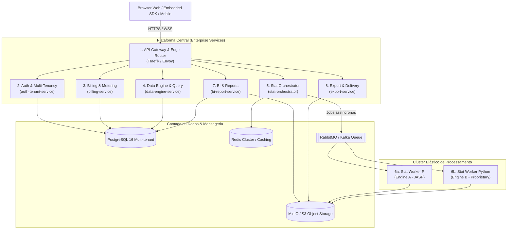

# Plano de Arquitetura e Implementação — Metastatistic Commercial (Enterprise & Microservices)

Plataforma unificada corporativa e B2B SaaS de Business Intelligence, Data Preparation e Rigor Estatístico Avançado (Frequentista e Bayesiano), combinando o melhor do [JASP](https://github.com/jasp-stats/jasp-desktop) e do [Metabase](https://github.com/metabase/metabase).

---

## 1. Visão Executiva e Posicionamento de Mercado

### 1.1 Transformação do Produto: Do Monólito Experimental ao Enterprise SaaS
O **Metastatistic Commercial** nasce da necessidade de transicionar um protótipo de análise local/monolítica para uma infraestrutura distribuída, altamente escalável, multi-inquilino (*multi-tenant*), segura e pronta para monetização comercial.

A proposta de valor central é eliminar o abismo existente entre ferramentas de **Business Intelligence corporativo** (rápidas, visuais, voltadas a métricas simples e dashboards operacionais) e softwares de **análise estatística especializada** (pesados, desktop-bound, focados em pesquisa acadêmica e inferência rigorosa).

```
┌──────────────────────────────────────────────────────────────────────────────┐
│                            METANASTATISTIC COMMERCIAL                        │
│                                                                              │
│    AGILIDADE E CONECTIVIDADE BI                 RIGOR E CIÊNCIA ESTATÍSTICA  │
│         (DNA Metabase)                               (DNA JASP)              │
│  - Conectores SQL heterogêneos             - Formato de publicação APA 7th   │
│  - Query Builder visual (sem código)        - Inferência Frequentista & Bayes │
│  - Cross-filtering & Dashboards            - Diagnósticos (QQ-plot, Resíduos)│
│  - Governança, Metadados e Catálogo        - Relatórios reprodutíveis        │
│                                      ▲                                       │
│                                      │                                       │
│                     DIFERENCIAIS COMPETITIVOS ÚNICOS                         │
│   • Relatórios com Blocos Híbridos (Texto rico + BI interativo + Estatística)│
│   • Filtros Dinâmicos Globais que recalculam gráficos E testes inferenciais   │
│   • Interpretação Narrativa Automatizada de P-valor e Fatores de Bayes (BF) │
│   • SDK de Incorporação (@metastatistic/react-embed) para outros SaaS        │
└──────────────────────────────────────────────────────────────────────────────┘
```

### 1.2 Casos de Uso Comerciais e Setores-Alvo
1. **Empresas de Pesquisa Clínica & Indústria Farmacêutica (CROs / Pharma)**:
   - Validação de ensaios clínicos, bioequivalência, testes A/B farmacológicos e relatórios auditáveis compatíveis com FDA 21 CFR Part 11 e boas práticas de laboratório (GxP).
2. **FinTechs, Risco, Crédito & Seguradoras**:
   - Modelagem de escores de crédito, análise de sobrevivência para default, testes de hipóteses de risco de mercado e relatórios de compliance para bancos centrais.
3. **Instituições de Ensino Superior, Centros de Pesquisa & Laboratórios**:
   - Plataforma em nuvem colaborativa para estudantes, docentes e pesquisadores substituindo licenças legadas individuais de SPSS/SAS por uma solução web moderna e colaborativa.
4. **Corporações & Escalas de Data Science / Product Analytics**:
   - Times de experimentação (growth, marketing, produto) conduzindo testes A/B/n bayesianos com dashboards executivos integrados ao data warehouse (Snowflake/BigQuery/Postgres).

---

## 2. Estratégia de Licenciamento, Compliance e Propriedade Intelectual (AGPL-3.0 vs Solução Proprietária)

### 2.1 O Desafio Jurídico do Copyleft AGPL
Tanto o código-fonte original do **JASP Desktop** quanto o **Metabase** utilizam a licença **GNU Affero General Public License v3 (AGPL-3.0)**. 
No modelo SaaS e em distribuições corporativas proprietárias (*On-Premise closed-source*), a AGPL impõe que qualquer modificação ou obra derivada disponibilizada pela rede tenha seu código-fonte integral aberto sob a mesma licença, representando risco de contaminação aos ativos intelectuais comerciais.

### 2.2 Arquitetura "Dual-Engine" e Isolamento de Rede

Para neutralizar esse risco e permitir uma oferta comercial híbrida (Open Core + Enterprise Fechado), o sistema adota uma fronteira estrita por arquitetura distribuída:

```
                  ┌─────────────────────────────────────────────────────────┐
                  │          Metastatistic Commercial Platform              │
                  │   (Proprietária / Enterprise / B2B SaaS Closed Source)  │
                  └────────────┬──────────────────────────────┬─────────────┘
                               │                              │
             Contrato IPC/gRPC │            Contrato Interno  │
               via Rede Aberta │             Python / Native  │
                               ▼                              ▼
    ┌──────────────────────────────────────┐     ┌──────────────────────────────┐
    │       ENGINE A (Open Engine)         │     │   ENGINE B (Enterprise Core) │
    │ ------------------------------------ │     │ ---------------------------- │
    │ • Licença: AGPL-3.0 / GPL Compliance │     │ • Licença: Proprietária      │
    │ • Runtimes: R + jaspTools            │     │ • Runtimes: Python / Rust    │
    │ • Módulos: jaspDescriptives,         │     │ • Stack: SciPy, Statsmodels, │
    │   jaspTTests, jaspAnova,             │     │   Pingouin, PyMC, Polars,    │
    │   jaspRegression, etc.               │     │   Apache Arrow Nativo        │
    │ • Comunicação: gRPC / Arrow IPC      │     │ • Ideal para: On-Premise,    │
    │ • Execução em Worker Containers      │     │   Air-Gapped, Finanças e     │
    │   100% isolados de rede pública      │     │   Clientes estritos sem AGPL │
    └──────────────────────────────────────┘     └──────────────────────────────┘
```

1. **Engine A (Open Engine - Módulos JASP R)**:
   - Opera como um microsserviço autônomo e desacoplado (`stat-worker-r`).
   - Comunica-se exclusivamente através de chamadas IPC/gRPC serializadas em Apache Arrow sobre sockets de rede.
   - Todo o código contido neste serviço é mantido em conformidade com a AGPL-3.0, mas não contamina os demais serviços da plataforma (Gateway, Auth, Billing, Data Engine e UI), que permanecem proprietários sob o princípio de agregação independente de rede (*independent network-separated services*).
2. **Engine B (Enterprise Engine - Pure Python / Rust / Julia)**:
   - Motor proprietário livre de código AGPL construído com bibliotecas licenciadas sob BSD, MIT e Apache 2.0 (SciPy, Statsmodels, Pingouin, Scikit-learn, PyMC, Polars, DuckDB).
   - Replica com precisão os algoritmos matemáticos e tabelas APA 7th.
   - Fornece garantia contratual de IP limpo (*indemnification*) para clientes corporativos de grande porte que proíbem qualquer componente AGPL em suas redes internas.

---

## 3. Topologia e Decomposição em Microsserviços

A plataforma adota arquitetura orientada a serviços (*Microservices & Event-Driven Architecture*), orquestrada em Kubernetes com contratos estritos baseados em OpenAPI v3 e Protocol Buffers / gRPC.



### 3.1 Detalhamento de Cada Microsserviço

#### 1. API Gateway & Edge Router (`apps/gateway`)
- **Tecnologia**: Traefik Enterprise ou Envoy Proxy.
- **Responsabilidades**:
  - Roteamento inteligente baseado em subdomínios de inquilinos (`{org_slug}.metastatistic.com` e domínios personalizados).
  - Terminação TLS automática (Let's Encrypt / Cert-Manager).
  - Verificação prévia de JWT, validação de tokens de API corporativos e CORS dinâmico.
  - Rate limiting adaptativo segregado por tier de assinatura (ex: Free: 60 req/min, Enterprise: 5.000 req/min).
  - OpenTelemetry distributed tracing e correlação de `X-Correlation-ID`.

#### 2. Identity, Multi-Tenancy & Access Management (`services/auth-tenant`)
- **Tecnologia**: Go ou Python FastAPI com SQLAlchemy 2.0 / Pydantic.
- **Responsabilidades**:
  - Estrutura hierárquica multi-tenant: Organizações (*Tenants*), Espaços de Trabalho (*Workspaces*), Equipes e Usuários.
  - Single Sign-On (SSO) corporativo: Integração com SAML 2.0 e OIDC (Okta, Azure Active Directory, PingFederate, Google Workspace).
  - SCIM 2.0 (*System for Cross-domain Identity Management*) para provisionamento e desprovisionamento automatizado de usuários por equipes de TI.
  - Controle de Acesso Baseado em Papéis e Atributos (RBAC/ABAC):
    - `Owner`, `Org Admin`, `Workspace Admin`, `Data Engineer`, `Senior Statistician`, `Analyst`, `Viewer`.
  - Trilha de Auditoria imutável (*Audit Logs*) para compliance com SOC 2 e HIPAA.

#### 3. Billing, Quotas & Usage Metering (`services/billing`)
- **Tecnologia**: Python FastAPI / Node.js.
- **Responsabilidades**:
  - Integração com Stripe Billing e Paddle para gestão de assinaturas, faturas automáticas e pagamentos via cartão/invoice corporativo.
  - Telemetria de consumo em tempo real:
    - Segundos de computação de Workers R e Python.
    - Armazenamento de datasets e snapshots no Object Storage (GBs/mês).
    - Execuções de consultas em Data Warehouses externos.
    - Contagem de assentos (*seats*) ativos.
  - Motor de limites de cotas com *soft limits* (notificações por email/webhook aos 80% e 90%) e *hard limits* (bloqueio gracioso de novas análises com upgrade prompt).

#### 4. Data Query & Transformation Engine (`services/data-engine`)
- **Tecnologia**: Python com DuckDB, Apache Arrow, Polars e SQLGlot.
- **Responsabilidades**:
  - Gerenciamento de Conexões Externas com pools seguros: PostgreSQL, MySQL, Snowflake, BigQuery, ClickHouse, Redshift, Amazon Athena, MariaDB e S3 Parquet/Delta Lake.
  - Federação de Consultas com DuckDB em memória: execução de queries locais ultrarrápidas sobre arquivos e caches.
  - Data Prep / Recipe Engine:
    - Transformações sem código: filtragem, categorização, criação de colunas calculadas, substituição de nulos, pivot/unpivot, agregação e mescla (*joins*).
    - Validação sintática e AST com SQLGlot para prevenção de SQL Injection e validação de dialetos.
  - Mascaramento e Segurança de Dados:
    - *Row-Level Security* (RLS) dinâmico baseado no perfil do usuário conectado.
    - Mascaramento de colunas sensíveis (PII / LGPD / GDPR) antes da entrega aos estatísticos.

#### 5. Statistical Orchestration Service (`services/stat-orchestrator`)
- **Tecnologia**: Python FastAPI + Celery / RabbitMQ + Redis.
- **Responsabilidades**:
  - Ingestão de pedidos de análise via contratos estritos JSON Schema (especificação unificada de variáveis dependentes, fatores, hipóteses, testes post-hoc, etc.).
  - Cache determinístico distribuído: cálculo do hash do dataset e do payload da análise:
    $$\text{CacheKey} = \text{SHA256}(\text{DatasetFingerprint} \parallel \text{AnalysisSpecJson} \parallel \text{EngineVersion})$$
    Evita reprocessamentos custosos de análises idênticas.
  - Gerenciamento de filas de tarefas com priorização estrita por tier de cliente:
    - Fila `vip-enterprise` (processamento prioritário e workers dedicados).
    - Fila `standard-saas`.
    - Fila `community-batch`.
  - Servidor WebSocket para emissão de progresso passo a passo aos clientes web.

#### 6. Stat Workers Cluster (`services/stat-worker-r` & `services/stat-worker-py`)
- **Tecnologia**:
  - Worker R: Debian/Ubuntu slim com R 4.3+, `jaspTools`, módulos R oficiais do JASP e `arrow`.
  - Worker Python: Python 3.12 slim com `scipy`, `statsmodels`, `pingouin`, `pymc`, `polars`, `pyarrow`.
- **Mecanismos de Segurança e Escalonamento**:
  - Autoscaling Horizontal via **KEDA** (Kubernetes Event-driven Autoscaling) escalando de 0 a centenas de pods conforme a profundidade da fila RabbitMQ.
  - Sandboxing com limites estritos de `cgroups` (CPU e RAM por container).
  - Execução como usuário sem privilégios (`non-root`).
  - Timeout forçado por análise (ex: 60s standard, 600s enterprise).
  - Sistema de arquivos temporário efêmero em RAM (`tmpfs`), destruído imediatamente após o envio dos resultados para o Object Storage.

#### 7. BI, Reporting & Collaboration Service (`services/bi-report`)
- **Tecnologia**: Node.js / TypeScript com NestJS ou Python FastAPI.
- **Responsabilidades**:
  - Gestão de Dashboards com layouts de grid dinâmico (React Grid Layout), cross-filtering interativo e parâmetros globais sincronizados.
  - Editor de Relatórios em blocos:
    - Integração com ProseMirror / TipTap para edição rica.
    - Suporte a blocos dinâmicos de estatística: tabelas em padrão estrito APA 7th, equações LaTeX/KaTeX, gráficos ECharts responsivos e interpretações textuais com IA.
  - Colaboração em Tempo Real utilizando CRDTs com **Yjs** e WebSockets (múltiplos estatísticos e analistas editando o mesmo relatório simultaneamente com presença de cursores).
  - Versionamento de Relatórios: snapshots imutáveis arquivados no S3 com trilha de alterações (revisões históricas restauráveis).

#### 8. Export & Delivery Service (`services/export`)
- **Tecnologia**: Node.js com Playwright (Chromium Headless), Python com `python-docx` e LaTeX Compiler.
- **Responsabilidades**:
  - Geração de PDFs de alta fidelidade:
    - Renderização do DOM do relatório em resolução vetorial para impressão.
    - Quebras de página inteligentes (*page-break-inside: avoid* para tabelas APA e gráficos).
    - Numeração dinâmica de páginas, cabeçalhos, rodapés e sumário executivo gerado automaticamente.
  - Exportação nativa de relatórios editáveis para DOCX (Word), PPTX (PowerPoint) e arquivos `.tex` (LaTeX acadêmico).
  - Motor de Agendamento (Cron Scheduler): disparo recorrente de relatórios por e-mail (SendGrid / AWS SES) ou canais corporativos (Slack, Microsoft Teams, Webhooks).

#### 9. Frontend Enterprise (`apps/web-enterprise`)
- **Tecnologia**: Next.js 15+ (App Router), React 19, TypeScript, Tailwind CSS, shadcn/ui, Apache ECharts, Monaco Editor.
- **Responsabilidades**:
  - Interface do usuário com padrão visual refinado e responsivo.
  - Suporte a temas corporativos (White-labeling com logos, cores da marca e fontes customizadas para planos Enterprise).
  - Pacote `@metastatistic/react-embed`:
    - SDK JavaScript/React para incorporação (*iframe seguro* e *web component*) de dashboards e gráficos estatísticos em sistemas legados dos clientes com autenticação via JWT assinado.

---

## 4. Arquitetura de Dados e Persistência

### 4.1 Transição do Armazenamento Monolítico para Nuvem Corporativa

No protótipo inicial, utilizava-se SQLite (`meta.db`) e arquivos CSV locais em disco. Na solução comercial, a arquitetura de persistência é segregada em quatro camadas resilientes:

| Camada | Tecnologia | Propósito | Estratégia de Isolamento Multi-Tenant |
|---|---|---|---|
| **Metadados & Transações** | PostgreSQL 16+ (Amazon RDS / Cloud SQL) | Usuários, organizações, permissões, definições de relatórios, dashboards, queries e conexões | **Pool compartilhado com Row-Level Security (RLS)** nativo para planos Standard; **Schema-per-tenant** ou **Database-per-tenant** para Enterprise VIP |
| **Object Storage** | MinIO / AWS S3 / Cloudflare R2 | Datasets em formato Apache Parquet, snapshots de relatórios, PDFs exportados e artefatos de modelo | Chave de prefixo estruturada: `s3://metastatistic-{region}/{tenant_id}/{workspace_id}/{file_uuid}.parquet` com criptografia SSE-S3 / SSE-KMS |
| **Cache & Sessões** | Redis Cluster 7+ | Cache de queries, sessões de usuário, locks distribuídos e pub/sub para websockets | Keysnamespacing: `tenant:{tenant_id}:cache:{hash}` |
| **Fila de Mensageria** | RabbitMQ / Apache Kafka | Fila de análises estatísticas assíncronas, webhooks e pipelines de exportação | Filas separadas com prioridade por QoS e suporte a Dead-Letter Exchanges (DLX) |

### 4.2 Estratégia de Isolamento Multi-Tenancy no PostgreSQL

```sql
-- Exemplo de isolamento por Row-Level Security (RLS) no PostgreSQL
ALTER TABLE reports ENABLE ROW LEVEL SECURITY;

CREATE POLICY tenant_isolation_policy ON reports
    FOR ALL
    USING (tenant_id = current_setting('app.current_tenant_id', true)::uuid);
```

Para clientes do tier **Enterprise On-Premise**, a persistência é completamente autônoma, operando dentro do cluster Kubernetes da própria empresa, sem nenhuma partilha com outros clientes.

---

## 5. Matriz de Planos Comerciais e Monetização

O modelo de negócio baseia-se em **SaaS B2B baseado em assinatura (com precificação baseada em assentos e valor agregado de computação)**, complementado por licenças corporativas anuais para grandes empresas:

| Recurso / Funcionalidade | Community (Open-Core) | Team (SaaS) | Enterprise SaaS | Enterprise On-Premise / Air-Gapped |
|---|---|---|---|---|
| **Público-Alvo** | Desenvolvedores & Estudantes | Pequenos times e consultorias | Médias e grandes empresas | CROs, Bancos, Defesa e Saúde |
| **Modelo de Cobrança** | Gratuito (Auto-hospedado) | $49/usuário/mês | $149/usuário/mês (mín. 10) | Contrato Anual Customizado |
| **Engine Estatístico** | Engine A (JASP R AGPL) | Engine A (JASP R) | Engine A ou Engine B (Dual) | **Engine B (100% Proprietário)** |
| **Isolamento de Dados** | Local / SQLite | Multi-Tenant (RLS) | Multi-Tenant (Schema Dedicado) | **Single-Tenant Totalmente Privado** |
| **SSO & Governança** | E-mail / Senha simples | E-mail / Google Auth | SAML 2.0, Okta, Azure AD, SCIM | SAML 2.0, SCIM, LDAP Local |
| **Conectores de Banco** | CSV / SQLite / Postgres | Postgres, MySQL, BigQuery | Todos + Snowflake, Athena, Databricks | Conectores customizados e VPC Peering |
| **Capacidade de Computação** | 1 Worker local | Fila compartilhada | **Workers dedicados (KEDA)** | **Cluster local autônomo** |
| **Embeddable Analytics SDK** | ❌ Não disponível | ❌ Não disponível | ✅ Sim (com marca d'água) | ✅ Sim (White-label total) |
| **Suporte & SLAs** | Fórum GitHub | Horário Comercial (e-mail) | 99.9% SLA + Gerente Dedicado | 99.99% SLA + Suporte 24/7/365 |
| **Certificações & Compliance**| Nenhuma | Termos padrão | SOC 2 Tipo II, HIPAA BAA | 21 CFR Part 11, GxP, ISO 27001 |

---

## 6. Roteiro Fases de Implementação (Roadmap)

### Fase 1: Preparação do Fork e Desacoplamento de Contratos (Semanas 1–2)
- [ ] Inicialização da estrutura Monorepo (pnpm / Turborepo ou Nx) com:
  - `packages/contracts`: Schemas TypeScript, Pydantic e JSON Schema unificados para análises estatísticas e queries.
  - `packages/sdk`: SDK cliente em TypeScript para consumo da API.
  - `packages/ui`: Componentes de design system reutilizáveis (shadcn/ui + Tailwind).
- [ ] Refatoração da persistência:
  - Adição de suporte ao PostgreSQL com migrações gerenciadas via Alembic / Prisma.
  - Inclusão sistemática de `tenant_id` em todas as entidades relacionais.
- [ ] Criação de abstração de armazenamento de objetos (`StorageProvider`) com suporte a S3 e MinIO local.

### Fase 2: Gateway, Auth Multi-Tenant e Billing (Semanas 3–5)
- [ ] Implementação do serviço `auth-tenant-service`:
  - Criação de Organizações, Workspaces e Gestão de Convites.
  - Sistema de permissões RBAC com middlewares de autorização.
- [ ] Configuração do API Gateway com terminação TLS e roteamento baseado em subdomínio de inquilino.
- [ ] Implementação do serviço `billing-service`:
  - Integração com webhooks do Stripe para criação e cancelamento de planos.
  - Middleware de medição de uso e enforcement de cotas.

### Fase 3: Separação do Data Engine e Conectores SQL (Semanas 6–8) ✅ CONCLUÍDA (2026-11-07)
- [x] Extração da lógica de consulta para o microsserviço `data-engine-service`:
  - Conectores externos para SQLite, DuckDB, PostgreSQL e MySQL com verificação de conectividade e latência.
  - Integração do DuckDB em memória com conversão zero-copy para streaming Apache Arrow IPC (`POST /queries/arrow`).
  - Execução de queries em sandbox confinada com validação AST via SQLGlot e bloqueio de DDL/DML.
- [x] Refatoração do Data Prep / Recipe Engine:
  - Execução de etapas de transformação via AST do SQLGlot e DuckDB (`POST /transforms/preview`).
  - Mascaramento dinâmico de PII (email, CPF, telefone, redaction e SHA-256 salgado com isolamento de tenant).
- [x] Integração no API Gateway e Docker Compose:
  - Roteamento de `/api/v1/queries/*`, `/api/v1/transforms/*` e `/api/v1/connections/*` no Gateway.
  - Healthcheck unificado agregando `data-engine-service`.
  - Serviço `data-engine-service` configurado no `docker-compose.microservices.yml` (porta 8014:8004).

### Fase 4: Orquestração e Cluster de Workers com Autoscaling (Semanas 9–11)
- [x] Construção do microsserviço `stat-orchestrator`:
  - Fila assíncrona de jobs com suporte a prioridade por tier (VIP Enterprise vs Standard) e controle de concorrência.
  - Implementação do cache LRU determinístico de análises (hash de tenant, dataset, opções e colunas).
  - API com endpoints `/health`, `/analyses/status`, `/jobs/submit`, `/jobs/{job_id}` e `/analyses/run`.
- [x] Construção e empacotamento dos containers de Workers e Orquestração:
  - R Engine Adapter com forward para workers R e healthcheck ativo.
  - Integração no API Gateway e orquestração Docker Compose (`docker-compose.microservices.yml`).
- [x] Início e implementação do **Engine B** em Python (`scipy`, `numpy`) para independência total de AGPL:
  - Estatísticas Descritivas (`descriptives`).
  - Teste t Independente (`ttest_independent`) e Teste t de Uma Amostra (`ttest_onesample`).
  - ANOVA One-Way (`anova`).
  - Correlação de Pearson (`correlation`).
  - Formatação rigorosa de tabelas e notas conforme APA 7th.
  - Roteamento Dual-Engine inteligente ('py', 'r', 'auto').

### Fase 5: Microsserviço de Relatórios, BI e Exportação (Semanas 12–14) ✅ CONCLUÍDA (2026-11-07)
- [x] Implementação do serviço `bi-report-service`:
  - CRUD com bloqueio otimista de versão (conflito 409) para relatórios e dashboards.
  - Snapshots imutáveis de versão com restauração instantânea.
  - Dashboards reativos com grade flexível de tiles e suporte a filtros multi-dimensionais.
  - Colaboração em tempo real via WebSockets (`/ws/reports/{report_id}`).
  - Isolamento multi-tenant estrito via `X-Tenant-ID`.
- [x] Desenvolvimento do serviço `export-service`:
  - Exportação HTML editorial e PDF com CSS Paged Media (`@page { size: A4; margin: 2.5cm; }`) e tabelas APA 7th.
  - Gerador de exportação para LaTeX acadêmico com pacotes `booktabs` e `amsmath`.
  - Gerador de exportação para Microsoft Word DOCX via `python-docx` com estilos e tabelas APA.
  - Gerador de exportação para Markdown GFM com blocos matemáticos KaTeX.
  - Roteador polimórfico unificado em `POST /export/generate`.
- [x] Desenvolvimento e publicação do pacote `@metastatistic/react-embed`:
  - Componente React seguro embutível via iframe com sandbox restritivo.
  - Sincronização bidirecional de eventos e comandos via `postMessage`.
  - Redimensionamento automático dinâmico (`autoResize`), suporte a temas (`light`/`dark`) e filtros.
- [x] Atualização do API Gateway e Docker Compose com proxy reverso e healthcheck integrado.

### Fase 6: Prontidão Enterprise, Segurança e Lançamento (Semanas 15–16) ✅ CONCLUÍDA (2026-11-09)
- [x] Implementação de SSO corporativo (SAML 2.0 / Okta / Azure AD / OIDC) com provisionamento Just-In-Time (JIT) em `services/auth-tenant-service/app/sso.py`.
- [x] Implementação de provisionamento de identidades SCIM 2.0 (RFC 7643 e RFC 7644) com suporte a Okta e Azure AD (`/scim/v2/tenants/{tenant_id}/*`).
- [x] Implementação de Trilha de Auditoria imutável (*Audit Logs*) criptograficamente encadeada com SHA-256 (Merkle/blockchain-style) e verificação matemática de adulteração em tempo real para conformidade com SOC 2 Tipo II e FDA 21 CFR Part 11 em `services/auth-tenant-service/app/audit_trail.py`.
- [x] Atualização de rotas no API Gateway (`services/gateway/app/proxy.py`) para rotear SSO, SCIM 2.0 e Audit Trail.
- [x] Criação de Helm Charts oficiais Kubernetes Enterprise (`deploy/helm/metastatistic`) com `Chart.yaml`, `values.yaml`, HPA, Ingress TLS, ConfigMap, Secrets e pares Deployment/Service para os 7 microsserviços.
- [x] Testes automatizados completos de SSO, SCIM, Auditoria com teste de adulteração física direta no banco e 100% de aprovação (56 testes backend no monorepo).
- [x] Documentação técnica detalhada em `docs/commercial-phase6-progress.md`.
