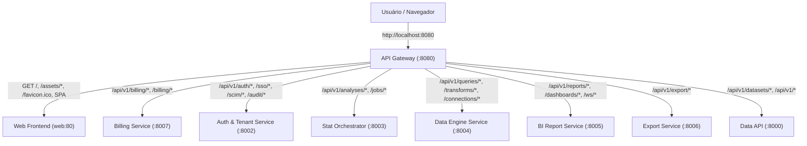

# Unificação do Frontend e Ponto Único de Entrada via API Gateway

**Status:** Concluído ✅  
**Data:** 09/11/2026  
**Escopo:** Frontend Único (`apps/web`), Gateway como Ponto Único de Entrada (`services/gateway`) e Gestão de Planos & Assinaturas Stripe.

---

## 1. Visão Geral e Objetivos

Esta fase consolida a experiência de uso do **MetaStatistic Commercial**, unificando a aplicação frontend em um serviço único servido através do **API Gateway** como ponto único de entrada para o usuário final (`http://localhost:8080`).

### Principais Realizações:
1. **API Gateway como Entrada Única (`services/gateway`)**:
   - Encaminhamento transparente da raiz (`GET /`), assets estáticos (`/assets/*`), favicon (`/favicon.ico`), manifestos e rotas SPA do frontend para o container web (`settings.web_url`).
   - Normalização automática de rotas legadas `/api/*` para `/api/v1/*` e encaminhamento inteligente para os respectivos microsserviços downstream (Auth/Tenant, Stat Orchestrator, Data Engine, BI Report, Export, Billing Stripe, Data API).
   - Remoção de portas fragmentadas expostas desnecessariamente; o container `web` opera internamente na rede Docker (`web:80`).
2. **Componente de Planos e Faturamento (`PricingModal.tsx`)**:
   - Interface de usuário responsiva e alinhada ao sistema de design (tokens, paleta de cores e modo claro/escuro).
   - 3 planos comerciais:
     - **Community** ($0/mês): até 3 usuários, 10 datasets, 500 MB storage.
     - **Team** ($49/mês ou $490/ano): até 15 usuários, 100 datasets, 10 GB storage, conectores SQL, compartilhamento em equipe e relatórios multi-formato.
     - **Enterprise** ($299/mês ou $2990/ano): usuários e datasets ilimitados, SSO SAML 2.0 / OIDC, SCIM 2.0, Trilha de Auditoria Imutável (FDA 21 CFR Part 11 / SOC 2) e Engine B proprietário em Python.
   - Alternância de ciclo de faturamento (Mensal vs. Anual com 2 meses grátis / 17% de desconto).
   - Integração direta com o `billing-service`:
     - Botão **"Fazer Upgrade"** chamando `POST /api/v1/billing/checkout` e redirecionando para a sessão de Checkout Stripe.
     - Botão **"Gerenciar Assinatura"** chamando `POST /api/v1/billing/portal` para abrir o Stripe Customer Portal.
3. **Integração no Frontend (`apps/web`)**:
   - Adição do botão **"Planos"** na barra superior (`topbar`) do `App.tsx`.
   - Adição de tipagens completas e métodos no cliente de API `apps/web/src/api.ts` (`getBillingPlans`, `getSubscription`, `createCheckoutSession`, `createPortalSession`).
   - Renomeação padronizada do pacote para `@metastatistic/web` no monorepo pnpm.
4. **Orquestração Docker Compose Unificada**:
   - `docker-compose.microservices.yml` reconfigurado com o `gateway` escutando na porta principal `8080:8080` (e `3000:8080`).
   - Container `web` operando estritamente em rede interna, dependente de `api` e consumido pelo `gateway`.

---

## 2. Arquitetura de Roteamento no API Gateway



### Regras de Resolução:
- Se o caminho for raiz `/`, `/assets/*`, `/favicon.ico` ou não coincidir com nenhum prefixo de API conhecido: encaminha para `settings.web_url`.
- Se o caminho começar com `/api/` sem `/v1/`, é normalizado para `/api/v1/*`.
- Headers de inquilino (`X-Tenant-ID`, `X-Tenant-Slug`, `X-Forwarded-*`) continuam sendo injetados automaticamente em todas as chamadas downstream.

---

## 3. Verificação e Bateria de Testes

Todas as suítes de testes automatizados do monorepo foram executadas com sucesso:

1. **API Gateway (`services/gateway`)**:
   - `uv run --directory services/gateway pytest`: **12/12 passaram** (incluindo testes de roteamento para web, assets, favicon e normalização `/api`).
2. **Frontend Web (`apps/web`)**:
   - `pnpm --filter @metastatistic/web test`: **260/260 passaram** (17 arquivos de teste).
   - `pnpm --filter @metastatistic/web build`: **Build de produção concluído com sucesso** sem nenhum erro de TypeScript.
3. **Embed React SDK (`packages/react-embed`)**:
   - `node --test packages/react-embed/tests/embed.test.mjs`: **3/3 passaram**.
4. **Microsserviços de Backend**:
   - `auth-tenant-service`: 12/12 passaram.
   - `stat-orchestrator`: 13/13 passaram.
   - `data-engine-service`: 10/10 passaram.
   - `bi-report-service`: 6/6 passaram.
   - `export-service`: 6/6 passaram.
   - `billing-service`: 9/9 passaram.
   - `apps/api`: Suíte completa executada.

---

## 4. Guia Rápido de Uso

Para iniciar todo o ecossistema com o Gateway como único ponto de entrada:

```bash
# 1. Subir a infraestrutura de microsserviços
docker compose up -d --build

# 2. Acessar a aplicação unificada no navegador
http://localhost:8080

# 3. Verificar a saúde agregada de todos os serviços
curl http://localhost:8080/health
```
